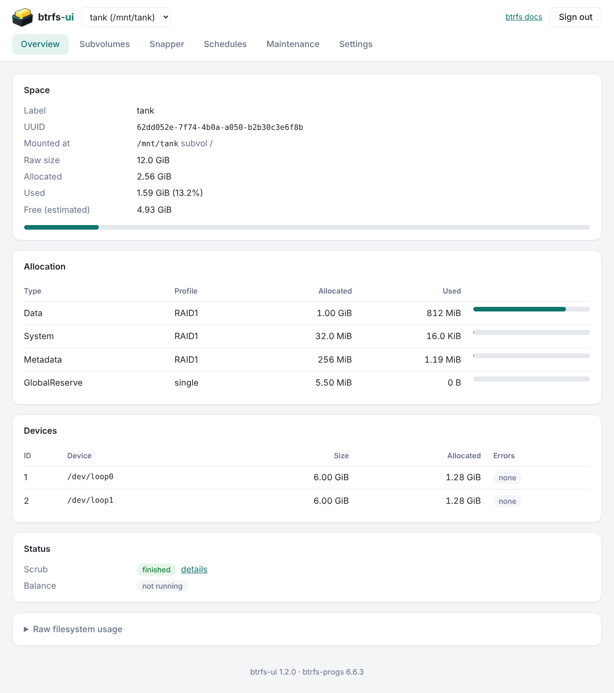
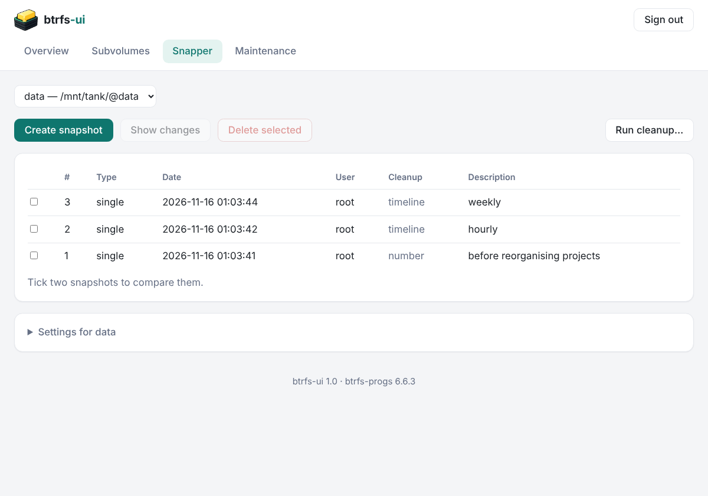

<p align="center">
  
</p>

<h1 align="center">btrfs-ui</h1><br>

<p align="center">
  A web UI for managing btrfs on headless servers, packaged in a lightweight docker container.<br>
  Supports space and device health, subvolumes and snapshots, snapper, scrub, balance, defrag and trim.
</p><br>

<table>
  <tr>
    <td>
      <a href="docs/screenshots/overview-light.png"><picture>
        <source media="(prefers-color-scheme: dark)" srcset="docs/screenshots/overview-dark.png">
        
      </picture></a>
    </td>
    <td>
      <a href="docs/screenshots/subvolumes-light.png"><picture>
        <source media="(prefers-color-scheme: dark)" srcset="docs/screenshots/subvolumes-dark.png">
        
      </picture></a>
    </td>
  </tr>
  <tr>
    <td>
      <a href="docs/screenshots/snapper-light.png"><picture>
        <source media="(prefers-color-scheme: dark)" srcset="docs/screenshots/snapper-dark.png">
        
      </picture></a>
    </td>
    <td>
      <a href="docs/screenshots/maintenance-light.png"><picture>
        <source media="(prefers-color-scheme: dark)" srcset="docs/screenshots/maintenance-dark.png">
        
      </picture></a>
    </td>
  </tr>
</table>

We love btrfs-assistant, but unfortunately it is a desktop app, and remembering cli commands can be annoying. 

This little app bridges the gap between running a whole desktop gui and only using cli commands. It's about time btrfs had a dedicated lightweight docker container so that you can manage your headless servers from a browser.

This build contains a Flask backend that runs `btrfs` and `snapper`, with some plain HTML, CSS and a JS front end.
<br><br>

## Features

- **Overview**: raw/allocated/used/free space, allocation by profile, per-device size and
  error counters, scrub and balance state, raw `filesystem usage`.
- **Subvolumes**: list with snapshot / read-only / mounted flags and creation time,
  sizes when quotas are enabled, create, snapshot, toggle read-only, delete.
- **Snapper**: list, create and delete snapshots, compare two snapshots, edit the
  timeline/number retention settings, run cleanup.
- **Maintenance**: scrub (start, cancel, resume), balance with usage filters, defragment
  (with optional recompression), trim, and a list of background jobs with their output.

Not included compared with btrfs-assistant: deduplication (bees/duperemove),
btrfsmaintenance configuration, enabling or disabling quotas, snapper rollback, and
adding or removing devices.
<br><br>

## Docker Compose

   ```yaml
   services:
     btrfs-ui:
       image: ghcr.io/thornygravy/btrfs-ui:latest
       container_name: btrfs-ui
       ports:
         - "8008:8008"
       cap_add:
         - SYS_ADMIN           # required for btrfs ioctls (subvolume delete, scrub, balance, ...)
       security_opt:
         - no-new-privileges:true
       environment:
         BTRFS_UI_PASSWORD: "change-me"
         # BTRFS_UI_READONLY: "1"                # browse only, no changes
         # BTRFS_UI_COOKIE_SECURE: "1"           # set when served over HTTPS
       volumes:
         - /mnt/btrfs-root:/mnt/btrfs-root     # top level (subvolid=5) to make subvolumes reachable
         - /var/lib/btrfs:/var/lib/btrfs     # scrub history
         # - /etc/snapper:/etc/snapper     # only for the Snapper tab
         # - /mnt/btrfs-root/@data:/mnt/btrfs-root/@data     # each config directory
       restart: unless-stopped
   ```

Change the password (container will refuse to start otherwise), then head to: http://ip-of-sever:8008 .

Feel free to build the image from scratch.
<br><br>

## Requirements

| Setting | Why |
| --- | --- |
| `cap_add: SYS_ADMIN` | btrfs ioctls (delete subvolume, scrub, balance, defrag, trim) are refused without it. |
| Bind mounts of your btrfs mount points | The container only sees what you mount into it. Use the **same path as on the host**. |
| `/var/lib/btrfs` from the host | btrfs stores scrub history there. Without it the UI cannot see past scrubs and says "never run". |
| `/etc/snapper` (optional) | Only for the Snapper tab. |

No `/dev` access is needed. It runs as root inside the container, which btrfs requires.

Start the container after the filesystems are mounted on the host. A mount added later
is not visible to a container that is already running.

### Scrub history

`btrfs scrub status` reads its history from `/var/lib/btrfs/scrub.status.<UUID>`, and
that file lives on the host. The compose file bind-mounts the host's `/var/lib/btrfs`
into the container, so the UI shows scrubs that were started elsewhere (a cron job, a
shell) as well as the ones you start here. If you replace that mount with a Docker volume
or drop it, the container sees an empty directory and every filesystem reports
"never run".<br>

### Snapper

Snapper is run directly (`snapper --no-dbus`), so no daemon or D-Bus is needed. Create
configs on the host as usual (`snapper -c data create-config /mnt/btrfs-root/@data`); the
UI manages the snapshots, not the config creation.

Share the configs with the container by mounting `/etc/snapper` (uncomment that line in
the compose file). Each config also names a directory (`SUBVOLUME=` in
`/etc/snapper/configs/<name>`), and that exact path has to exist inside the container. If
it is inside a filesystem you already mount, like `/mnt/btrfs-root/@data` above, there is
nothing more to do. If it is somewhere else, mount it at the same path as on the host:

```yaml
volumes:
  - /etc/snapper:/etc/snapper
  - /srv/photos:/srv/photos      # a config with SUBVOLUME="/srv/photos"
```
<br>

## Configuration

All through environment variables.

| Variable | Default | |
| --- | --- | --- |
| `BTRFS_UI_PASSWORD` | – | **Required** unless auth is off. |
| `BTRFS_UI_PASSWORD_FILE` | – | Read the password from a file (Docker secret). |
| `BTRFS_UI_AUTH` | `on` | `off` disables the login (only if something in front already authenticates). |
| `BTRFS_UI_READONLY` | off | `1` = view everything, change nothing. |
| `BTRFS_UI_COOKIE_SECURE` | off | `1` when served over HTTPS. |
| `BTRFS_UI_SECRET` | random | Session signing key. Set it if you want logins to survive restarts. |
| `BTRFS_UI_HOST` / `BTRFS_UI_PORT` | `0.0.0.0` / `8008` | Listen address inside the container. |
| `BTRFS_UI_SNAPPER_ROOT` | – | Experimental, see above. |
<br>

## Security

This UI can delete subvolumes and snapshots and start long, heavy operations, so treat
it like root access to the storage.

- The container refuses to start without a password (or with an obvious placeholder).
  Login attempts are rate limited.
- The compose file publishes port 8008 so you can reach the UI from anywhere on your
  LAN. Keep it on your LAN and do not forward the port to the internet. The password is
  sent in clear text over plain HTTP; if you want HTTPS, put a reverse proxy in front
  (Caddy, nginx, Traefik) and set `BTRFS_UI_COOKIE_SECURE=1`.
- The session cookie is `HttpOnly` and `SameSite=Strict`, and every change needs a
  custom request header, which blocks cross-site requests.
- Every path you type is resolved and must end up inside a mounted btrfs filesystem
  (`..` and symlinks that leave it are rejected). Commands are run without a shell.
- Deleting is refused for the top-level subvolume, the default subvolume and anything
  mounted in the container.
- `BTRFS_UI_READONLY=1` is a good way to try it out: everything is visible, nothing can
  be changed.
  <br><br>
  

## Build it yourself

Clone or download this repository, then in `docker-compose.yml` replace the `image:`
line with `build: .`. Start it with `docker compose up -d --build`.
<br><br>


## Troubleshooting

- **"No btrfs filesystems are mounted inside this container"**: the container only sees
  paths you bind-mount. Mount the filesystem into it and restart the container.
- **Scrub says "never run"**: the host's `/var/lib/btrfs` is not mounted into the
  container, or that filesystem really has no scrub history. Compare the UUID on the
  Overview tab with the file names in `/var/lib/btrfs` on the host.
- **An update does not show up**: run `docker compose pull && docker compose up -d` and
  check the version in the footer. If you build it yourself, add `--build` instead.
- **Snapper tab is empty**: see "Snapper" above; the configs and the snapshotted
  directories both have to be mounted at the same paths as on the host.
  <br><br>
  

## Development

```sh
pip install -r requirements.txt pytest
python -m pytest tests            # parsers, API, and a loopback-btrfs integration test (needs root)

BTRFS_UI_AUTH=off BTRFS_UI_PORT=8008 python -m app      # run without Docker
```

The parsers are tested against output captured from btrfs-progs 6.6.3 and snapper
0.10.6 (`tests/fixtures`). The integration tests create a btrfs filesystem on a
loopback file and are skipped when that is not possible.
<br><br>

## License

[MIT](LICENSE)
