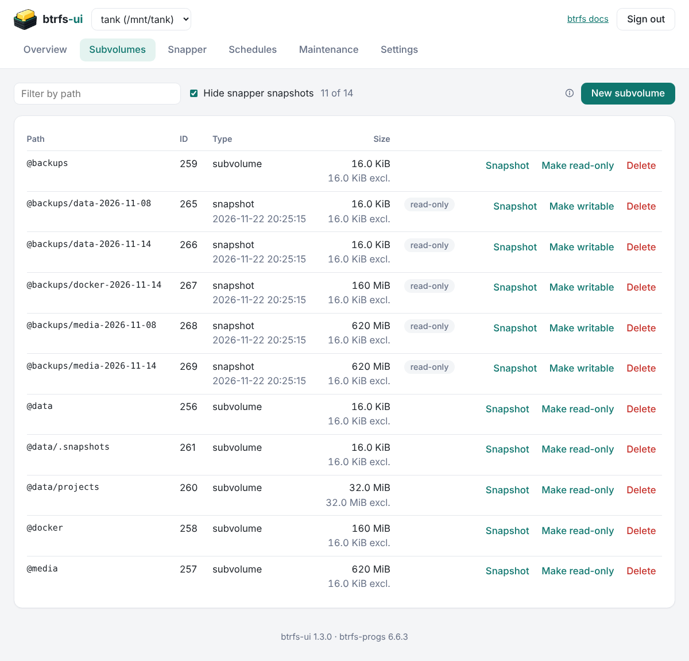
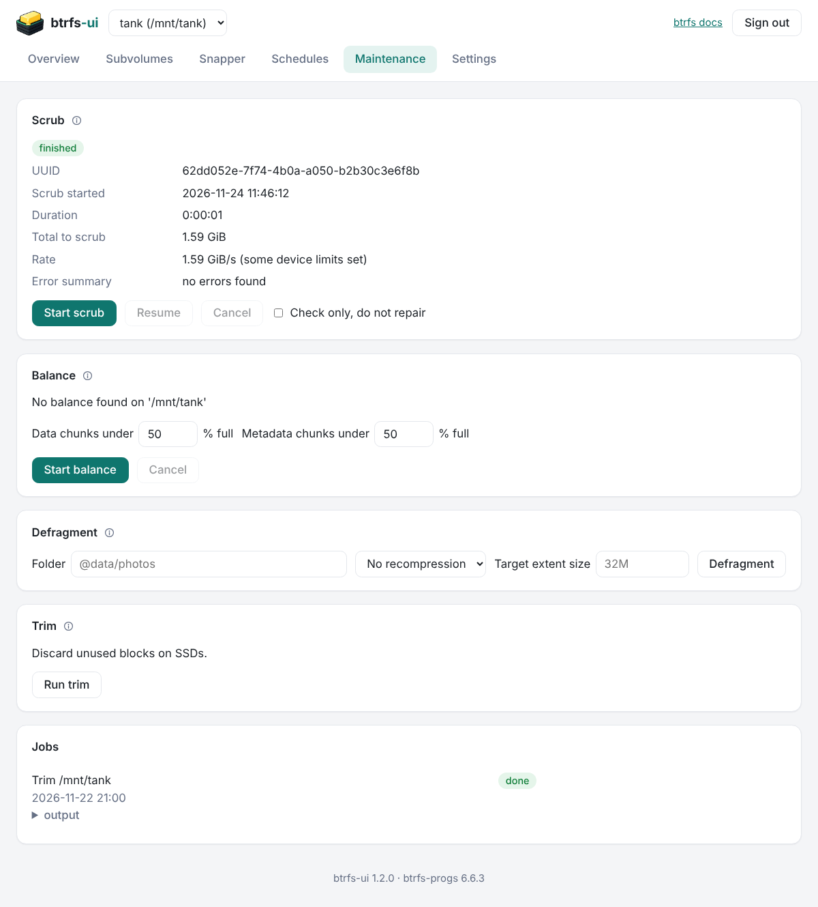
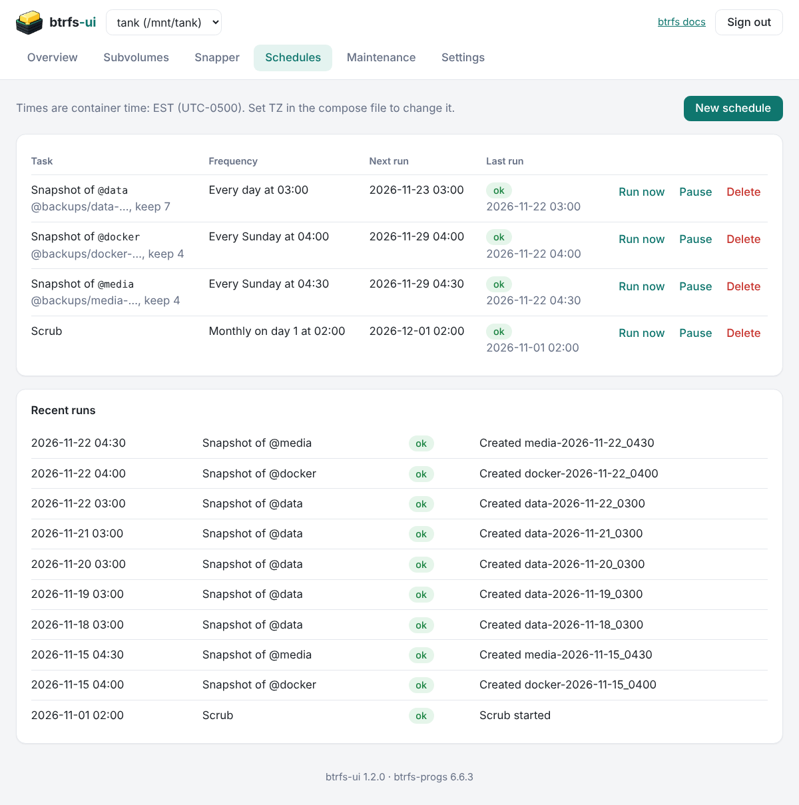

<p align="center">
  
</p>

<h1 align="center">btrfs-ui</h1><br>

<p align="center">
  A web UI for managing btrfs on headless servers, packaged in a lightweight docker container.<br>
  Supports space and device health, subvolumes and snapshots, snapper, scrub, balance, defrag and trim.
</p><br>

<table>
  <tr>
    <td>
      <a href="docs/screenshots/overview-light.png"><picture>
        <source media="(prefers-color-scheme: dark)" srcset="docs/screenshots/overview-dark.png">
        
      </picture></a>
    </td>
    <td>
      <a href="docs/screenshots/subvolumes-light.png"><picture>
        <source media="(prefers-color-scheme: dark)" srcset="docs/screenshots/subvolumes-dark.png">
        
      </picture></a>
    </td>
  </tr>
  <tr>
    <td>
      <a href="docs/screenshots/snapper-light.png"><picture>
        <source media="(prefers-color-scheme: dark)" srcset="docs/screenshots/snapper-dark.png">
        
      </picture></a>
    </td>
    <td>
      <a href="docs/screenshots/maintenance-light.png"><picture>
        <source media="(prefers-color-scheme: dark)" srcset="docs/screenshots/maintenance-dark.png">
        
      </picture></a>
    </td>
  </tr>
</table>
<br>
This app bridges the gap between running a whole desktop gui and only using cli commands. It's about time btrfs had a dedicated lightweight container to manage your headless servers from a browser. <br><br>

Obviously we're in the super early stages of this project and using Claude to help, but welcome to all help. If you have any idea, or experience a bug, please feel free to contribute.
<br><br>

## Features

- **Overview**: raw/allocated/used/free space, allocation by profile, per-device size and
  error counters, scrub and balance state, raw `filesystem usage`.
- **Subvolumes**: list with snapshot / read-only / mounted flags and creation time,
  sizes when quotas are enabled, create, snapshot, toggle read-only, delete.
- **Snapper**: list, create and delete snapshots, compare two snapshots, edit the
  timeline/number retention settings, run cleanup.
- **Schedules**: take snapshots on a schedule and keep only the newest few, or run a
  scrub on a schedule. Needs the `/data` volume, see below.
- **Notifications**: optionally send a webhook message (for example to Home Assistant)
  when a scrub finds errors or a scheduled snapshot or scrub fails. See below.
- **Maintenance**: scrub (start, cancel, resume), balance with usage filters, defragment
  (with optional recompression), trim, and a list of background jobs with their output.

Not included compared with btrfs-assistant: deduplication (bees/duperemove),
btrfsmaintenance configuration, enabling or disabling quotas, snapper rollback, and
adding or removing devices.
<br><br>

## Docker Compose

   ```yaml
   services:
     btrfs-ui:
       image: ghcr.io/thornygravy/btrfs-ui:latest
       container_name: btrfs-ui
       ports:
         - "8008:8008"
       cap_add:
         - SYS_ADMIN           # required for btrfs ioctls (subvolume delete, scrub, balance, ...)
       security_opt:
         - no-new-privileges:true
       environment:
         - TZ=America/New_York
         - BTRFS_UI_PASSWORD=change-me
         # - BTRFS_UI_READONLY=1                # browse only, no changes
         # - BTRFS_UI_COOKIE_SECURE=1           # set when served over HTTPS
         # - BTRFS_UI_WEBHOOK_URL=http://192.168.1.10:8123/api/webhook/your-long-id   # message when a scrub finds errors or a schedule fails
         # - BTRFS_UI_WEBHOOK_SCRUB_OK=1        # also message when a scrub finishes clean
       volumes:
         - /mnt/btrfs-root:/mnt/btrfs-root     # top level (subvolid=5) to make subvolumes reachable
         - /var/lib/btrfs:/var/lib/btrfs     # scrub history
         - /appdata/btrfs-ui/data:/data     # schedules and their history (optional)
         # - /etc/snapper:/etc/snapper     # only for the Snapper tab
         # - /mnt/btrfs-root/@data:/mnt/btrfs-root/@data     # each config directory
       restart: unless-stopped
   ```

Change the password (the container refuses to start otherwise), then open `http://<your-server-ip>:8008` in a browser.
<br><br>

## Requirements

| Setting | Why |
| --- | --- |
| `cap_add: SYS_ADMIN` | btrfs ioctls (delete subvolume, scrub, balance, defrag, trim) are refused without it. |
| Bind mounts of your btrfs mount points | The container only sees what you mount into it. Use the **same path as on the host**. |
| `/var/lib/btrfs` from the host | btrfs stores scrub history there. Without it the UI cannot see past scrubs and says "never run". |
| `/etc/snapper` (optional) | Only for the Snapper tab. |
| `/data` (optional) | Only for the Schedules tab. Keeps your schedules and what they have run. |

No `/dev` access is needed. It runs as root inside the container, which btrfs requires.

Start the container after the filesystems are mounted on the host. A mount added later
is not visible to a container that is already running.

### Scrub history

`btrfs scrub status` reads its history from `/var/lib/btrfs/scrub.status.<UUID>`, and
that file lives on the host. The compose file bind-mounts the host's `/var/lib/btrfs`
into the container, so the UI shows scrubs that were started elsewhere (a cron job, a
shell) as well as the ones you start here. If you replace that mount with a Docker volume
or drop it, the container sees an empty directory and every filesystem reports
"never run".<br>

### Snapper

Snapper is run directly (`snapper --no-dbus`), so no daemon or D-Bus is needed. Create
configs on the host as usual (`snapper -c data create-config /mnt/btrfs-root/@data`); the
UI manages the snapshots, not the config creation.

Share the configs with the container by mounting `/etc/snapper` (uncomment that line in
the compose file). Each config also names a directory (`SUBVOLUME=` in
`/etc/snapper/configs/<name>`), and that exact path has to exist inside the container. If
it is inside a filesystem you already mount, like `/mnt/btrfs-root/@data` above, there is
nothing more to do. If it is somewhere else, mount it at the same path as on the host:

```yaml
volumes:
  - /etc/snapper:/etc/snapper
  - /srv/photos:/srv/photos      # a config with SUBVOLUME="/srv/photos"
```

### Schedules

The Schedules tab runs two kinds of job on a schedule (hourly, daily, weekly or
monthly): a snapshot of a subvolume, or a scrub.

<p>
  <a href="docs/screenshots/schedules-light.png"><picture>
    <source media="(prefers-color-scheme: dark)" srcset="docs/screenshots/schedules-dark.png">
    
  </picture></a>
</p>

Snapshots are read-only and are named `prefix-YYYY-MM-DD_HHMM` in a folder you pick.
After each new snapshot, the ones beyond the number you chose to keep are deleted. Only
snapshots that schedule made are ever touched (matching name, read-only, a snapshot of
the same subvolume), so anything you made by hand in that folder is left alone. A scrub
is skipped if one is already running.

Schedules and a short history are saved in `/data`, which is why the compose file mounts
`./data:/data`. Without it the tab says so and nothing is scheduled. Times are the
container's time, so set `TZ` in the compose file. If the container was down when a run
was due, it runs once when the container starts. In read-only mode schedules are shown
but never run.

Scrubs started by cron or OMV still show up in the UI (it reads `/var/lib/btrfs`), but
btrfs-ui does not manage those schedules. If something else already snapshots or scrubs
on a schedule, use one or the other so you do not get doubles.

### Notifications

Set `BTRFS_UI_WEBHOOK_URL` and btrfs-ui sends a small JSON message to that address when a
scrub finishes with errors, or when a scheduled snapshot or scrub fails. It looks at
`btrfs scrub status` once a minute, so a scrub started by hand, by a schedule or by cron
is covered. Add `BTRFS_UI_WEBHOOK_SCRUB_OK=1` to hear about clean scrubs too.
**Settings → Notifications** has a button that sends a test message.

```json
{"event": "scrub_errors", "title": "Scrub found errors on tank", "message": "...", "filesystem": "tank"}
```

`event` is `scrub_errors`, `schedule_failed`, `scrub_ok` or `test`.

For Home Assistant, create an automation with a webhook trigger and a notify action.
The webhook ID is the only secret, so make it long and random:

```yaml
alias: btrfs-ui
trigger:
  - platform: webhook
    webhook_id: btrfs-ui-change-this-to-something-long
action:
  - service: notify.mobile_app_your_phone
    data:
      title: "{{ trigger.json.title }}"
      message: "{{ trigger.json.message }}"
```

Then set `BTRFS_UI_WEBHOOK_URL=http://192.168.1.10:8123/api/webhook/btrfs-ui-change-this-to-something-long`
(your Home Assistant address). Use an IP address or a DNS name the container can
resolve: `localhost` is the container itself, and `.local` names often do not work
inside Docker. Newer Home Assistant versions write `trigger: webhook` instead of
`platform: webhook`.

Only the host is ever shown in the UI, and the address is never written to the logs. A
scrub that finishes while the container is down is not reported.
<br>

## Configuration

All through environment variables.

| Variable | Default | |
| --- | --- | --- |
| `BTRFS_UI_PASSWORD` | – | **Required** unless auth is off. |
| `BTRFS_UI_PASSWORD_FILE` | – | Read the password from a file (Docker secret). |
| `BTRFS_UI_AUTH` | `on` | `off` disables the login (only if something in front already authenticates). |
| `BTRFS_UI_READONLY` | off | `1` = view everything, change nothing. |
| `BTRFS_UI_COOKIE_SECURE` | off | `1` when served over HTTPS. |
| `BTRFS_UI_SECRET` | random | Session signing key. Set it if you want logins to survive restarts. |
| `BTRFS_UI_HOST` / `BTRFS_UI_PORT` | `0.0.0.0` / `8008` | Listen address inside the container. |
| `BTRFS_UI_SNAPPER_ROOT` | – | Experimental, see above. |
| `BTRFS_UI_DATA_DIR` | `/data` | Where schedules are saved. |
| `BTRFS_UI_WEBHOOK_URL` | – | Where to send a JSON message when a scrub finds errors or a schedule fails, for example a Home Assistant webhook. |
| `BTRFS_UI_WEBHOOK_SCRUB_OK` | off | `1` = also send a message when a scrub finishes with no errors. |
| `TZ` | `UTC` | Container time zone. Schedule times, and the times snapper and scrub show, follow it. |
<br>

## Security

This UI can delete subvolumes and snapshots and start long, heavy operations, so treat
it like root access to the storage.

- The container refuses to start without a password (or with an obvious placeholder).
  Login attempts are rate limited.
- The compose file publishes port 8008 so you can reach the UI from anywhere on your
  LAN. Keep it on your LAN and do not forward the port to the internet. The password is
  sent in clear text over plain HTTP; if you want HTTPS, put a reverse proxy in front
  (Caddy, nginx, Traefik) and set `BTRFS_UI_COOKIE_SECURE=1`.
- The session cookie is `HttpOnly` and `SameSite=Strict`, and every change needs a
  custom request header, which blocks cross-site requests.
- Every path you type is resolved and must end up inside a mounted btrfs filesystem
  (`..` and symlinks that leave it are rejected). Commands are run without a shell.
- Deleting is refused for the top-level subvolume, the default subvolume and anything
  mounted in the container.
- `BTRFS_UI_READONLY=1` is a good way to try it out: everything is visible, nothing can
  be changed.
  <br><br>
  

## Build it yourself

Clone or download this repository, then in `docker-compose.yml` replace the `image:`
line with `build: .`. Start it with `docker compose up -d --build`.
<br><br>


## Troubleshooting

- **"No btrfs filesystems are mounted inside this container"**: the container only sees
  paths you bind-mount. Mount the filesystem into it and restart the container.
- **Scrub says "never run"**: the host's `/var/lib/btrfs` is not mounted into the
  container, or that filesystem really has no scrub history. Compare the UUID on the
  Overview tab with the file names in `/var/lib/btrfs` on the host.
- **An update does not show up**: run `docker compose pull && docker compose up -d` and
  check the version in the footer. If you build it yourself, add `--build` instead.
- **Snapper tab is empty**: see "Snapper" above; the configs and the snapshotted
  directories both have to be mounted at the same paths as on the host.
- **Schedules tab says schedules are off**: mount a folder at `/data` (`- ./data:/data`
  in the compose file) and restart the container.
- **The test message fails**: the message in the UI says why. "HTTP 404" usually means
  the webhook ID does not match the automation, and "Could not reach" means the address
  is wrong or not reachable from inside the container.
  <br><br>
  

## Development

```sh
pip install -r requirements.txt pytest
python -m pytest tests            # parsers, API, and a loopback-btrfs integration test (needs root)

BTRFS_UI_AUTH=off BTRFS_UI_PORT=8008 python -m app      # run without Docker
```

The parsers are tested against output captured from btrfs-progs 6.6.3 and snapper
0.10.6 (`tests/fixtures`). The integration tests create a btrfs filesystem on a
loopback file and are skipped when that is not possible.
<br><br>

## License

[MIT](LICENSE)
